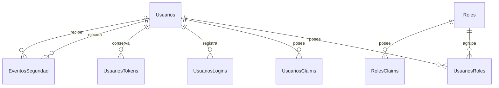
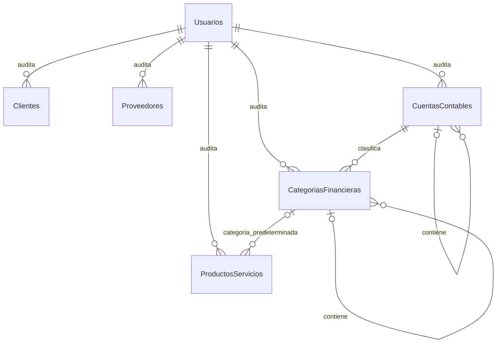

# Modelo de datos

## Convenciones iniciales

- Llaves primarias nuevas: `uniqueidentifier`/`Guid`.
- Tablas de seguridad: esquema SQL `seguridad`.
- Catálogos de partes y clasificación: esquema SQL `catalogos`.
- Documentos financieros: esquema SQL `finanzas`.
- Nombres únicos mediante valores normalizados de Identity.
- Precios de referencia: `decimal` con cuatro decimales declarados explícitamente.
- El sistema opera solo en colones (CRC); no hay moneda ni tipo de cambio.
- Instantes técnicos: UTC; fechas de documentos: fecha de negocio sin hora.
- Migraciones en `SistemaFinanciero.Infrastructure/Persistence/Migrations`.
- Códigos de catálogo recortados, normalizados a mayúsculas e indexados de forma única dentro de su
  propia tabla.
- Relaciones históricas y jerárquicas con borrado restringido.

## Esquema de seguridad implementado

La migración `InitialIdentity` crea las tablas de Identity y `AddUserAdministration` incorpora la
bitácora. El esquema resultante contiene:

### Diccionario de tablas

| Tabla | Propósito |
|---|---|
| `seguridad.Usuarios` | Identidad, credenciales hasheadas, bloqueo y estado lógico del usuario. |
| `seguridad.Roles` | Cuatro perfiles internos creados por el bootstrap explícito. |
| `seguridad.UsuariosRoles` | Relación muchos a muchos entre usuarios y roles. |
| `seguridad.UsuariosClaims` | Claims propios de un usuario, reservados para capacidades futuras. |
| `seguridad.RolesClaims` | Claims asociados a roles. |
| `seguridad.UsuariosLogins` | Metadatos de proveedores externos; no se usan en el alcance inicial. |
| `seguridad.UsuariosTokens` | Tokens generados por Identity. |
| `seguridad.EventosSeguridad` | Bitácora append-only de cambios administrativos de acceso, sin secretos. |
| `dbo.__EFMigrationsHistory` | Historial técnico de migraciones aplicadas. |

### `seguridad.Usuarios`

| Campo | Tipo SQL | Nulo | Restricción | Descripción |
|---|---|---:|---|---|
| `Id` | `uniqueidentifier` | No | PK | Identificador estable. |
| `FullName` | `nvarchar(150)` | No | — | Nombre mostrado y utilizado en trazabilidad. |
| `IsActive` | `bit` | No | Predeterminado 1 | Baja lógica; un usuario inactivo no accede. |
| `MustChangePassword` | `bit` | No | Predeterminado 0 | Restringe una contraseña temporal hasta que el propietario la cambia. |
| `UserName` | `nvarchar(256)` | No | Índice único normalizado | En esta versión coincide con el correo. |
| `NormalizedUserName` | `nvarchar(256)` | No | `UserNameIndex` único | Valor normalizado por Identity. |
| `Email` | `nvarchar(256)` | No | — | Correo utilizado para iniciar sesión. |
| `NormalizedEmail` | `nvarchar(256)` | No | `EmailIndex` único | Evita duplicados aun bajo concurrencia. |
| `EmailConfirmed` | `bit` | No | — | Marcador técnico; no hay servicio de correo. |
| `PasswordHash` | `nvarchar(max)` | Sí | — | Hash administrado exclusivamente por Identity. |
| `SecurityStamp` | `nvarchar(max)` | Sí | — | Permite invalidar sesiones ante cambios sensibles. |
| `ConcurrencyStamp` | `nvarchar(max)` | Sí | Concurrencia Identity | Detecta cambios concurrentes. |
| `PhoneNumber` | `nvarchar(max)` | Sí | — | Reservado por Identity; sin uso funcional inicial. |
| `PhoneNumberConfirmed` | `bit` | No | — | Reservado por Identity. |
| `TwoFactorEnabled` | `bit` | No | — | Reservado; MFA no forma parte del primer incremento. |
| `LockoutEnd` | `datetimeoffset` | Sí | — | Fin de un bloqueo temporal. |
| `LockoutEnabled` | `bit` | No | — | Habilita el control de intentos fallidos. |
| `AccessFailedCount` | `int` | No | — | Intentos fallidos acumulados por Identity. |

Las tablas auxiliares conservan las claves y relaciones definidas por ASP.NET Core Identity. Su esquema
exacto y reproducible está en la migración versionada; no deben editarse manualmente en SQL Server.

`ConcurrencyStamp` se presenta a la interfaz únicamente como una versión opaca. No se confunde con
`SecurityStamp`: el primero detecta formularios administrativos obsoletos y el segundo invalida cookies
después de cambios sensibles.

### `seguridad.EventosSeguridad`

| Campo | Tipo SQL | Nulo | Restricción | Descripción |
|---|---|---:|---|---|
| `Id` | `uniqueidentifier` | No | PK | Identificador inmutable del evento. |
| `Action` | `int` | No | Valor enumerado permitido | Alta, edición, rol, estado, contraseña, desbloqueo o bootstrap. |
| `ActorUserId` | `uniqueidentifier` | Sí | FK restrictiva | Administrador o propietario que ejecutó la acción; nulo solo para bootstrap. |
| `TargetUserId` | `uniqueidentifier` | No | FK restrictiva | Cuenta afectada por la acción. |
| `OccurredAtUtc` | `datetimeoffset` | No | UTC | Instante en que la transacción confirmó el cambio. |
| `Role` | `nvarchar(32)` | Sí | Rol fijo permitido | Rol nuevo cuando la acción necesita conservarlo. |

La entidad no posee operaciones de actualización o eliminación y no incluye campos para contraseña,
hash, token, correo, identificación ni información financiera. Los índices por instante, actor y
objetivo preparan la consulta futura de auditoría sin ampliar este incremento con un módulo de reportes.

## Modelo del incremento de catálogos

Cliente y proveedor son entidades separadas según ADR-0006. Las tablas financieras no almacenan
asientos contables, inventario ni un saldo editable de cuenta.

Cada relación de auditoría representa las referencias de creación y última modificación hacia
`seguridad.Usuarios`; nunca provoca borrado en cascada.

### Diccionario de tablas del incremento

| Tabla | Propósito |
|---|---|
| `catalogos.Clientes` | Personas u organizaciones a las que se puede facturar. |
| `catalogos.Proveedores` | Personas u organizaciones asociadas a gastos futuros. |
| `catalogos.ProductosServicios` | Catálogo facturable unificado, sin existencias de inventario. |
| `catalogos.CategoriasFinancieras` | Clasificación jerárquica de ingreso o gasto. |
| `catalogos.CuentasContables` | Catálogo jerárquico de cuentas de clasificación; incluye las cajas y bancos como cuentas de efectivo. |

### Campos comunes auditables

Clientes, proveedores, productos/servicios, categorías y cuentas comparten conceptualmente:

| Campo | Tipo SQL | Nulo | Restricción | Descripción |
|---|---|---:|---|---|
| `Id` | `uniqueidentifier` | No | PK | Identificador técnico estable. |
| `IsActive` | `bit` | No | Predeterminado 1 | Baja lógica; no elimina historia. |
| `CreatedAtUtc` | `datetimeoffset` | No | UTC | Instante de creación. |
| `CreatedByUserId` | `uniqueidentifier` | No | FK restrictiva | Usuario creador. |
| `UpdatedAtUtc` | `datetimeoffset` | No | UTC | Instante del último cambio. |
| `UpdatedByUserId` | `uniqueidentifier` | No | FK restrictiva | Usuario responsable del último cambio. |
| `RowVersion` | `rowversion` | No | Concurrencia | Evita sobrescrituras silenciosas. |

### `catalogos.Clientes` y `catalogos.Proveedores`

Ambas tablas tienen la misma forma inicial, pero no comparten identidad ni ciclo de vida:

| Campo | Tipo SQL | Nulo | Restricción | Descripción |
|---|---|---:|---|---|
| `Code` | `nvarchar(30)` | No | Único por tabla; inmutable | Código visible (`CLI-0001`/`PRV-0001`, regla 12) que asigna el sistema al crear, a partir de `catalogos.Seq_ClienteCodigo`/`Seq_ProveedorCodigo`. |
| `Name` | `nvarchar(150)` | No | — | Nombre completo o razón social. |
| `Identification` | `nvarchar(50)` | No | Único por tabla (`UX_Clientes_Identification`/`UX_Proveedores_Identification`) | Identificación fiscal o personal, obligatoria (RF-50/RF-51). |
| `Email` | `nvarchar(254)` | Sí | — | Correo de contacto. |
| `Phone` | `nvarchar(30)` | Sí | — | Teléfono de contacto. |
| `Address` | `nvarchar(500)` | Sí | — | Dirección administrativa. |
| `EconomicActivity` | `nvarchar(200)` | Sí | Solo en `Proveedores` | Actividad económica declarada del proveedor. |

La misma identificación puede existir en ambas tablas porque una persona puede cumplir ambos papeles.
Cambiar un registro no actualiza silenciosamente el otro. El código lo asigna el sistema al crear
(migración `AdjustExistingCatalogs`) y ya no se edita; antes era un campo libre del formulario.

### `catalogos.ProductosServicios`

| Campo | Tipo SQL | Nulo | Restricción | Descripción |
|---|---|---:|---|---|
| `Code` | `nvarchar(30)` | No | Único; inmutable | Código visible (`PRD-0001`/`SRV-0001` según `Type`, regla 12) que asigna el sistema al crear, a partir de `catalogos.Seq_ProductoCodigo`/`Seq_ServicioCodigo`. |
| `Name` | `nvarchar(150)` | No | — | Nombre facturable. |
| `Type` | Valor restringido | No | Producto/Servicio | Clasifica el artículo; no habilita inventario. |
| `Description` | `nvarchar(500)` | Sí | — | Descripción administrativa. |
| `UnitOfMeasure` | `nvarchar(30)` | No | — | Unidad visible para capturas futuras. |
| `ReferencePriceCrc` | `decimal(18,4)` | Sí | Mayor que cero | Precio de referencia en CRC. |
| `DefaultIncomeCategoryId` | `uniqueidentifier` | Sí | FK restrictiva a `catalogos.CategoriasFinancieras` | Categoría activa de ingreso sugerida; no obliga documentos futuros. |
| `DefaultTaxTypeId` | `uniqueidentifier` | Sí | FK restrictiva a `catalogos.TiposImpuesto` (`FK_ProductosServicios_TiposImpuesto`) | Tarifa de IVA activa que se propone al agregar el artículo a una línea de factura (RF-52); la línea puede cambiarla. |

El precio puede ser nulo para servicios de precio variable. Cuando existe se conserva con cuatro
decimales; el redondeo del total monetario se realizará al crear documentos. El código ya no se escribe
en el formulario: lo asigna el sistema según `Type` (migración `AdjustExistingCatalogs`).

### `catalogos.CategoriasFinancieras`

| Campo | Tipo SQL | Nulo | Restricción | Descripción |
|---|---|---:|---|---|
| `Code` | `nvarchar(30)` | No | Único; inmutable | Código visible (`ING-001`/`GAS-001` según `Kind`, regla 12) que asigna el sistema al crear, a partir de `catalogos.Seq_CategoriaIngresoCodigo`/`Seq_CategoriaGastoCodigo` (arrancan en 6 y 11 para no chocar con el catálogo base `ING-001..005`/`GAS-001..010` de `SeedBaseChartOfAccounts`). |
| `Name` | `nvarchar(120)` | No | — | Nombre de la categoría. |
| `Kind` | Valor restringido | No | Ingreso/Gasto; inmutable | Naturaleza financiera administrativa. |
| `ParentId` | `uniqueidentifier` | Sí | FK autorreferente restrictiva | Categoría padre del mismo tipo. |
| `LedgerAccountId` | `uniqueidentifier` | No | FK restrictiva a `catalogos.CuentasContables` (`FK_CategoriasFinancieras_CuentasContables`) | Cuenta contable de la categoría, del tipo Ingreso para las de ingreso y Gasto para las de gasto. |
| `Description` | `nvarchar(300)` | Sí | — | Explicación de uso. |

La aplicación impide autorreferencias, ciclos y padres de un tipo distinto. También bloquea la baja de
una categoría con hijas activas o artículos activos que la usan, y exige un padre activo al reactivar
una hija. No hay desactivación en cascada. La base restringe el borrado para conservar la jerarquía.
Que la cuenta sea del tipo que corresponde a la naturaleza lo valida la aplicación, porque involucra dos
tablas: como ni la naturaleza de la categoría ni el tipo de la cuenta pueden cambiar, la relación se
mantiene coherente después de validarla al asignarla.

### `catalogos.CuentasContables`

Comparte los campos comunes auditables de los catálogos: `Id`, `IsActive`, `CreatedAtUtc`,
`CreatedByUserId`, `UpdatedAtUtc`, `UpdatedByUserId` y `RowVersion` (ADR-0012).

| Campo | Tipo SQL | Nulo | Restricción | Descripción |
|---|---|---:|---|---|
| `Code` | `nvarchar(30)` | No | Único (`UX_CuentasContables_Code`); no vacío; inmutable | Código jerárquico (`3.1.07`) que el sistema calcula como el siguiente hijo libre del padre (regla 12). |
| `Name` | `nvarchar(120)` | No | — | Nombre de la cuenta. |
| `Type` | Entero | No | 1 = Activo, 4 = Ingreso, 5 = Gasto; inmutable | Naturaleza de la cuenta; sin pasivo ni patrimonio (regla 1). Se hereda de la cuenta superior al crear. |
| `ParentId` | `uniqueidentifier` | Sí | FK autorreferente restrictiva; distinta de `Id`; inmutable | Cuenta superior del mismo tipo, sin ciclos. Obligatoria al crear desde la interfaz (regla 13: el usuario solo agrega detalle dentro de un grupo). |
| `CashKind` | Entero | Sí | 1 = Caja, 2 = Banco; inmutable | Subtipo cuando la cuenta es de efectivo; nulo en las demás. |
| `Reference` | `nvarchar(100)` | Sí | — | Referencia no sensible; no debe almacenar credenciales bancarias. |
| `Description` | `nvarchar(300)` | Sí | — | Explicación de uso. |
| `IsProtected` | `bit` | No | Predeterminado 0 | Marca las cuentas de grupo del catálogo base (regla 13): no se renombran, ni cambian su referencia, ni se desactivan. Solo la siembra inicial la pone en 1; el dominio nunca la expone como parámetro de creación. |

`CK_CuentasContables_Cash` exige que una cuenta de efectivo (`CashKind` no nulo) sea de tipo Activo. Las
demás restricciones `CHECK` cubren el código no vacío, los valores permitidos de `Type` y `CashKind`, y
que una cuenta no sea su propia superior. La aplicación además valida, al crear, que la cuenta superior
esté activa y no sea de efectivo; después de creada, código, tipo y cuenta superior quedan fijos (regla
12): solo cambian nombre, referencia y descripción, y nunca en una cuenta protegida.

No existe un campo `Balance`: los saldos se calcularán en un incremento transaccional desde movimientos
confirmados y saldos iniciales controlados. La tabla anterior `finanzas.CuentasFinancieras` se migró aquí
y se eliminó (ADR-0012).

#### Catálogo base (regla 13, migración `SeedBaseChartOfAccounts`)

El sistema se instala con 9 cuentas de grupo protegidas y 17 cuentas de detalle (2 de efectivo, 5 de
ingreso y 10 de gasto), más una categoría financiera inicial por cada cuenta de detalle de ingreso o
gasto (mismo nombre, códigos `ING-001`–`ING-005` y `GAS-001`–`GAS-010`). Como estas filas necesitan un
usuario creador (FK obligatoria) y la migración corre antes de que exista cualquier usuario real, la
misma migración inserta primero un usuario técnico "Sistema" (`sistema@interno.local`, inactivo, sin
contraseña, sin rol) y lo usa como autor de todo el catálogo base.

| Código | Cuenta | Tipo | Clase |
|---|---|---|---|
| 1 | Activo | Activo | Grupo |
| 1.1 | Efectivo | Activo | Grupo |
| 1.1.01 | Caja chica | Activo (efectivo) | Detalle |
| 1.1.02 | Cuenta bancaria principal | Activo (efectivo) | Detalle |
| 2 | Ingresos | Ingreso | Grupo |
| 2.1 | Ingresos por servicios | Ingreso | Grupo |
| 2.1.01–2.1.03 | Soporte técnico; Mantenimiento y reparación de equipos; Instalación de infraestructura informática | Ingreso | Detalle |
| 2.2 | Ingresos por ventas | Ingreso | Grupo |
| 2.2.01 | Venta de equipos y repuestos | Ingreso | Detalle |
| 2.3 | Otros ingresos | Ingreso | Grupo |
| 2.3.01 | Otros ingresos de la operación | Ingreso | Detalle |
| 3 | Gastos | Gasto | Grupo |
| 3.1 | Gastos de operación | Gasto | Grupo |
| 3.1.01–3.1.06 | Alquiler; Electricidad y agua; Internet y telefonía; Materiales y repuestos; Software y licencias; Transporte y combustible | Gasto | Detalle |
| 3.2 | Gastos administrativos | Gasto | Grupo |
| 3.2.01–3.2.04 | Papelería y suministros de oficina; Servicios profesionales; Comisiones bancarias; Otros gastos administrativos | Gasto | Detalle |

Las cuentas de grupo (primer y segundo nivel) tienen `IsProtected = 1`. Las de detalle sembradas,
incluidas las de efectivo, no están protegidas: se pueden renombrar o inactivar como cualquier cuenta
que agregue el usuario después.

### `catalogos.TiposRetencion`

Catálogo de retenciones con tarifa porcentual (ADR-0013), complemento de `catalogos.TiposImpuesto`.
Comparte los campos comunes auditables de los catálogos: `Id`, `IsActive`, `CreatedAtUtc`,
`CreatedByUserId`, `UpdatedAtUtc`, `UpdatedByUserId` y `RowVersion`.

| Campo | Tipo SQL | Nulo | Restricción | Descripción |
|---|---|---:|---|---|
| `Code` | `nvarchar(30)` | No | Único (`UX_TiposRetencion_Code`); no vacío | Código visible normalizado en mayúsculas. |
| `Name` | `nvarchar(120)` | No | — | Nombre de la retención. |
| `Rate` | `decimal(18,4)` | No | Entre 0 y 100 (`CK_TiposRetencion_Rate`) | Porcentaje de retención. |
| `Description` | `nvarchar(300)` | Sí | — | Explicación de uso. |

Es la retención que un cliente obligado por ley aplica al pagar una factura (nunca un pago a un
proveedor); no viene precargada, la empresa define nombre y porcentaje. La base y el monto de una
retención concreta no se guardan aquí, porque dependen del abono al que se aplique; ese registro se
construirá junto con los abonos.

### `finanzas.ParametrosSistema` y `finanzas.ParametrosSistemaHistorial`

Cubren las reglas de negocio 7 y 9 (ADR-0014). No son un catálogo: `ParametrosSistema` admite como
máximo una fila, con el identificador fijo `00000000-0000-0000-0000-000000000001`, y no tiene baja
lógica.

| Campo (`ParametrosSistema`) | Tipo SQL | Nulo | Restricción | Descripción |
|---|---|---:|---|---|
| `Id` | `uniqueidentifier` | No | PK; siempre el identificador fijo | Fila única de parámetros. |
| `AuthorizationLimitCrc` | `decimal(18,2)` | No | Mayor o igual que cero (`CK_ParametrosSistema_AuthorizationLimit`) | Límite en CRC; los abonos y pagos por encima solo los registra Gerencia. |
| `OverdueAlertDays` | `int` | No | Mayor que cero (`CK_ParametrosSistema_OverdueAlertDays`) | Días de anticipación para la alerta de vencimiento próximo. |
| `CreatedAtUtc`, `CreatedByUserId`, `UpdatedAtUtc`, `UpdatedByUserId`, `RowVersion` | Como los campos comunes | No | FK restrictivas a usuarios | Auditoría y concurrencia. |

`ParametrosSistemaHistorial` es de solo inserción, igual que `seguridad.EventosSeguridad`; la aplicación
lo protege contra modificaciones y borrados (`FinancialDbContext.EnsureAppendOnlyLogsAreNotMutated`).

| Campo (`ParametrosSistemaHistorial`) | Tipo SQL | Nulo | Restricción | Descripción |
|---|---|---:|---|---|
| `Id` | `uniqueidentifier` | No | PK | Identificador del registro de cambio. |
| `PreviousAuthorizationLimitCrc` | `decimal(18,2)` | Sí | `>= 0` cuando existe | Límite anterior; nulo solo en el registro de la primera configuración. |
| `NewAuthorizationLimitCrc` | `decimal(18,2)` | No | `>= 0` | Límite nuevo. |
| `PreviousOverdueAlertDays` | `int` | Sí | `> 0` cuando existe | Días de alerta anteriores; nulos en la primera configuración. |
| `NewOverdueAlertDays` | `int` | No | `> 0` | Días de alerta nuevos. |
| `ChangedAtUtc` | `datetimeoffset` | No | Índice `IX_ParametrosSistemaHistorial_ChangedAtUtc` | Instante del cambio. |
| `ChangedByUserId` | `uniqueidentifier` | No | FK restrictiva | Usuario de Gerencia que hizo el cambio. |

## Incremento de facturación

Las facturas son documentos administrativos internos (ADR-0009 y ADR-0010). Tienen dos tablas en el
esquema `finanzas`. Los valores de los estados se guardan como enteros restringidos.

| Tabla | Propósito |
|---|---|
| `finanzas.Facturas` | Encabezado: cliente, fechas, condición de pago, estado y totales. |
| `finanzas.FacturaLineas` | Líneas de productos o servicios con su descripción, cantidades, importes y el IVA de cada una. |

### `finanzas.Facturas`

| Campo | Tipo SQL | Nulo | Restricción | Descripción |
|---|---|---:|---|---|
| `Id` | `uniqueidentifier` | No | PK | Identificador técnico estable. |
| `Number` | `bigint` identidad | No | Único (`UX_Facturas_Number`) | Consecutivo interno; no es numeración fiscal. |
| `CustomerId` | `uniqueidentifier` | No | FK restrictiva a `catalogos.Clientes` | Cliente facturado. |
| `IssueDate` | `date` | No | — | Fecha de negocio; editable solo en borrador. |
| `PaymentTerm` | Entero | No | 1 = contado, 2 = crédito 30 días, 3 = crédito 60 días, 4 = crédito 90 días | Condición de pago; lista fija de la regla 14, sin catálogo propio. |
| `DueDate` | `date` | Sí | Ver abajo | Vencimiento; lo calcula el dominio como `IssueDate` más los días del plazo, nunca se recibe. |
| `Status` | Entero | No | 1 = borrador, 2 = confirmada, 3 = anulada | Estado del documento. |
| `GrossAmount` | `decimal(18,2)` | No | Mayor o igual que cero | Total antes de descuentos e impuestos. |
| `DiscountAmount` | `decimal(18,2)` | No | Mayor o igual que cero | Total de descuentos. |
| `NetAmount` | `decimal(18,2)` | No | Mayor o igual que cero | Total antes de impuestos. |
| `TaxAmount` | `decimal(18,2)` | No | Mayor o igual que cero | Total de impuestos. |
| `TotalAmount` | `decimal(18,2)` | No | Mayor o igual que cero | Total a cobrar. |
| `ConfirmedAtUtc`, `ConfirmedByUserId` | `datetimeoffset`, `uniqueidentifier` | Sí | FK restrictiva a usuarios | Confirmación. |
| `CancellationReason`, `CancelledAtUtc`, `CancelledByUserId` | `nvarchar(300)`, `datetimeoffset`, `uniqueidentifier` | Sí | FK restrictiva a usuarios | Anulación con motivo. |
| `CreatedAtUtc`, `CreatedByUserId`, `UpdatedAtUtc`, `UpdatedByUserId` | Como los campos comunes | No | FK restrictivas a usuarios | Auditoría. |
| `RowVersion` | `rowversion` | No | Concurrencia | Evita sobrescrituras silenciosas. |

Restricciones `CHECK` de la tabla:
- `CK_Facturas_PaymentTerm`: la condición de pago es 1, 2, 3 o 4.
- `CK_Facturas_DueDate`: de contado (1) no tiene vencimiento; a crédito (2, 3 o 4) el vencimiento debe
  ser exactamente `IssueDate` más 30, 60 o 90 días según el plazo, con `DATEADD` — la misma fórmula
  que usa `Invoice.CalculateDueDate` en el dominio (regla 14, ADR-0020).
- `CK_Facturas_Status` y `CK_Facturas_Totals`.

Índices: `IX_Facturas_Status_IssueDate` y `IX_Facturas_CustomerId_Status`. Como las facturas no se
eliminan, no existe un campo de baja lógica: su ciclo de vida es el estado.

### `finanzas.FacturaLineas`

| Campo | Tipo SQL | Nulo | Restricción | Descripción |
|---|---|---:|---|---|
| `Id` | `uniqueidentifier` | No | PK | Identificador técnico de la línea. |
| `InvoiceId` | `uniqueidentifier` | No | FK en cascada a `Facturas` | Factura de origen. |
| `Position` | `int` | No | Mayor que cero; único por factura (`UX_FacturaLineas_InvoiceId_Position`) | Posición consecutiva desde 1 que conserva el orden de captura. |
| `CatalogItemId` | `uniqueidentifier` | Sí | FK restrictiva a `catalogos.ProductosServicios` | Artículo de origen; nulo en ventas no catalogadas. |
| `Description` | `nvarchar(300)` | No | — | Descripción conservada aunque el catálogo cambie. |
| `UnitOfMeasure` | `nvarchar(30)` | No | — | Unidad conservada. |
| `Quantity` | `decimal(18,4)` | No | Mayor que cero | Cantidad facturada. |
| `UnitPrice` | `decimal(18,4)` | No | Mayor o igual que cero | Precio unitario sin impuesto incluido. |
| `GrossAmount` | `decimal(18,2)` | No | Mayor o igual que cero | Cantidad por precio, redondeado. |
| `DiscountAmount` | `decimal(18,2)` | No | Entre cero y el bruto | Descuento monetario de la línea. |
| `NetAmount` | `decimal(18,2)` | No | Mayor o igual que cero | Bruto menos descuento; base gravable. |
| `TaxAmount` | `decimal(18,2)` | No | Mayor o igual que cero | Impuesto de la línea (igual a `Tax_Amount`). |
| `TotalAmount` | `decimal(18,2)` | No | Mayor o igual que cero | Neto más impuesto. |
| `TaxTypeId` | `uniqueidentifier` | Sí | FK restrictiva a `catalogos.TiposImpuesto` (`FK_FacturaLineas_TiposImpuesto`) | Tipo de impuesto del catálogo de origen; nulo si no se usó uno. |
| `Tax_Code` | `nvarchar(30)` | No | — | Código del IVA, normalizado en mayúsculas. |
| `Tax_Name` | `nvarchar(120)` | No | — | Nombre del IVA al aplicarlo. |
| `Tax_Rate` | `decimal(18,4)` | No | Mayor o igual que cero (`CK_FacturaLineas_Tax_RateAmount`) | Porcentaje de IVA utilizado. |
| `Tax_TaxableAmount` | `decimal(18,2)` | No | Mayor o igual que cero (`CK_FacturaLineas_Tax_RateAmount`) | Base gravable: el neto de la línea. |
| `Tax_Amount` | `decimal(18,2)` | No | Mayor o igual que cero (`CK_FacturaLineas_Tax_RateAmount`) | IVA calculado y redondeado. |

Cada línea lleva una sola tarifa de IVA, siempre presente (incluso Exento 0 %): es un tipo propietario
de EF Core (`InvoiceLine.Tax`), no una tabla aparte, así que vive como las columnas `Tax_*` de esta
misma tabla. Los cambios posteriores del catálogo de impuestos no alteran estos valores: código,
nombre, tarifa, base y monto son una copia. `TaxTypeId` solo registra de qué tipo del catálogo provino
y, al ser restrictiva, impide eliminar un tipo que ya se usó. La línea es inmutable: modificarla se
hace reemplazándola por otra con un identificador nuevo, que ocupa la misma posición. Al quitar una
línea se renumeran las siguientes para que las posiciones sigan siendo consecutivas.

### `catalogos.TiposImpuesto`

Catálogo de tarifas de IVA (ADR-0011). Solo el IVA, siempre porcentual: no existe un método de cálculo
de monto fijo. Comparte los campos comunes auditables de los catálogos: `Id`, `IsActive`,
`CreatedAtUtc`, `CreatedByUserId`, `UpdatedAtUtc`, `UpdatedByUserId` y `RowVersion`.

| Campo | Tipo SQL | Nulo | Restricción | Descripción |
|---|---|---:|---|---|
| `Code` | `nvarchar(30)` | No | Único (`UX_TiposImpuesto_Code`); no vacío | Código visible normalizado en mayúsculas. |
| `Name` | `nvarchar(120)` | No | — | Nombre del impuesto. |
| `Rate` | `decimal(18,4)` | No | Entre 0 y 100 (`CK_TiposImpuesto_Rate`) | Porcentaje de IVA. |
| `Description` | `nvarchar(300)` | Sí | — | Explicación de uso. |

Índice `IX_TiposImpuesto_IsActive_Name` para los listados. Un tipo con tarifa cero representa los
impuestos exentos o de tarifa 0 %, que se distinguen por su código y nombre. Las claves foráneas de
auditoría no provocan borrado en cascada y no existe eliminación física: se usa la baja lógica.

## Estado de la base de desarrollo

El 22 de agosto de 2026 se verificó en `.\SQLEXPRESS`:

- base `SistemaFinanciero_Dev`;
- ocho tablas en el esquema `seguridad`;
- cuatro tablas en el esquema `catalogos` y dos tablas en el esquema `finanzas`;
- migraciones `InitialIdentity`, `AddBusinessCatalogs` y `AddUserAdministration` aplicadas con EF Core
  10.0.11;
- trece restricciones `CHECK`, ocho índices únicos, catorce claves foráneas y seis columnas
  `rowversion` en las tablas del incremento de catálogos;
- una tabla, una columna, cuatro restricciones `CHECK`, un índice único de rol y dos claves foráneas
  restrictivas agregadas por el incremento de usuarios;
- modelo de EF Core sincronizado con la última migración.

Los escenarios transaccionales de integración se ejecutaron dentro de transacciones revertidas. La
verificación posterior confirmó que no quedaron clientes, proveedores, productos/servicios,
categorías, cuentas, tasas, usuarios, roles, asignaciones ni eventos de seguridad de prueba en la base
de desarrollo.
